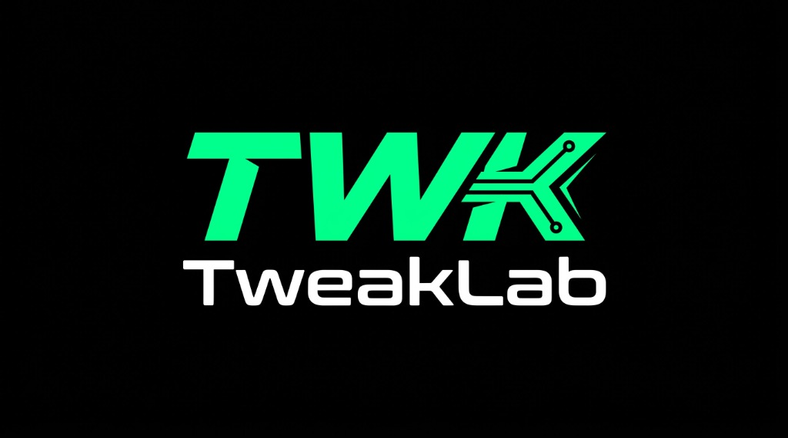

<div align="center">

  

  # TweakLab (TWK)
  **Plataforma de Suporte Técnico Remoto & Performance com Evidências**

  [](https://nextjs.org/)
  [](https://www.typescriptlang.org/)
  [](https://tailwindcss.com/)
  [](https://threejs.org/)
  [](LICENSE)

  <p align="center">
    Atendimento técnico especializado em Windows e computadores para jogos. Diagnósticos baseados em telemetria real, medições reprodutíveis e transparência total sobre cada intervenção no sistema.
  </p>

</div>

---

## ⚡ Visão & Metodologia

A maioria dos problemas de desempenho em jogos — como quedas bruscas de quadros e micro-travamentos (*stuttering*) — não decorre de falta de "otimizadores mágicos", mas sim de causas técnicas pontuais: conflitos de drivers, latência DPC excessiva, alocação inadequada de threads de renderização ou instabilidade térmica e de memória.

Na **TweakLab**, atuamos com rigor técnico:

- **Diagnosticar antes de intervir**: Análise aprofundada de arquivos de despejo (*Minidump* via WinDbg), registros do *Event Viewer* e medição de interrupções de kernel via *LatencyMon*.
- **Medição focada em 1% Low e Frametimes**: A média bruta de FPS frequentemente mascara instabilidades. Nosso objetivo primordial é a fluidez estável do mouse e a erradicação de engasgos durante tiroteios e momentos críticos.
- **Transparência e Reversibilidade**: Toda alteração possui justificativa técnica registrada em uma trilha de auditoria entregue no relatório final, com registro do estado anterior para reversão imediata.
- **Preservação da Segurança**: Não desativamos de forma indiscriminada proteções essenciais do Windows (*Windows Defender*, *UAC* e isolamento de núcleo).

---

## 🌟 Principais Recursos da Plataforma

- **Interactive 3D Hardware Telemetry**: Modelo 3D interativo do *die* de processador com PCB, heatpipes de cobre e cooler holográfico renderizado via WebGL/Three.js com 3 modos de inspeção (*Sólido*, *Wireframe* e *Térmico*).
- **Portal do Cliente**: Acompanhamento de chamados em tempo real, histórico de mensagens e pipeline de atendimento em 5 etapas.
- **Abertura Guiada de Chamados**: Triagem estruturada com relato de sintomas, coleta voluntária de especificações de hardware e termo explícito de consentimento.
- **Bancada Técnica & Log de Auditoria**: Interface para o especialista registrar cada ação técnica (com flag de reversibilidade) e lançar benchmarks comparativos antes/depois.
- **Relatório Técnico Exportável**: Emissão de relatório técnico completo pronto para impressão (`@media print` / PDF) com assinatura e hash criptográfico de validação.

---

## 🛠️ Tecnologias Utilizadas

- **Frontend**: [Next.js 15](https://nextjs.org/) (App Router, Server Components & Client Hooks)
- **Linguagem**: [TypeScript 5](https://www.typescriptlang.org/) (Tipagem estrita para dados de hardware, chamados e auditoria)
- **Estilização**: [Tailwind CSS 3.4](https://tailwindcss.com/) com design system customizado TWK (`#050605` obsidian, `#00FF88` Matrix Green)
- **Gráficos 3D**: [Three.js](https://threejs.org/) (Modelagem procedural otimizada para 60 FPS)
- **Ícones**: [Lucide React](https://lucide.dev/)
- **Backend / Database**: Arquitetura desacoplada, pronta para persistência em [Supabase](https://supabase.com/) (PostgreSQL + Row Level Security + Storage)

---

## 🚀 Como Executar o Projeto

### Pré-requisitos
- **Node.js** v20 ou superior
- **npm** ou **pnpm**

### Passo a Passo

```bash
# 1. Clone o repositório
git clone https://github.com/TwkLab/tweaklab.git

# 2. Acesse a pasta do projeto
cd tweaklab

# 3. Instale as dependências
npm install

# 4. Inicie o servidor de desenvolvimento
npm run dev
```

Abra [http://localhost:3000](http://localhost:3000) no seu navegador.

### Compilação para Produção

```bash
# Executa lint, checagem de tipos estritos e gera o build estático
npm run build

# Inicia o servidor em modo produção
npm run start
```

---

## 📁 Estrutura do Repositório

```
tweaklab/
├── .github/
│   └── workflows/ci.yml       # Pipeline automatizada de validação e build
├── public/
│   └── branding/              # Identidade visual oficial (2D, 3D badge e vetor)
├── src/
│   ├── app/
│   │   ├── layout.tsx         # Layout mestre, fontes e campo de partículas 3D
│   │   ├── globals.css        # Paleta TWK, utilitários HUD e scrollbar
│   │   ├── page.tsx           # Landing Page principal
│   │   ├── portal/            # Portal do Cliente (listagem, abertura e detalhe)
│   │   ├── admin/             # Painel do Técnico e Bancada de Diagnóstico
│   │   ├── relatorio/[id]/    # Relatório Técnico Oficial pronto para PDF
│   │   ├── termos/            # Termos de Atendimento e Responsabilidade
│   │   └── privacidade/       # Política de Privacidade & LGPD
│   ├── components/            # Componentes reutilizáveis (3D, HUD, Badges)
│   ├── data/                  # Mock inicial tipado de chamados e benchmarks
│   └── types/                 # Definições de tipos de chamados, auditoria e hardware
├── tailwind.config.ts
├── tsconfig.json
├── package.json
└── README.md
```

---

## 🗺️ Roadmap de Desenvolvimento

- [x] **Fase 1: Fundação & Identidade Web**
  - [x] Design system TWK com paleta oficial Dark Obsidian & Matrix Green
  - [x] Visualizador de hardware 3D interativo com WebGL
  - [x] Portal do Cliente, abertura guiada de chamado e linha do tempo
  - [x] Bancada do técnico com auditoria de ações e emissão de relatório PDF
- [ ] **Fase 2: Conexão de Dados & Autenticação**
  - [ ] Integração com Supabase (Postgres + Auth + Storage privado)
  - [ ] Políticas de isolamento de dados por usuário (Row Level Security)
- [ ] **Fase 3: Automação & Ferramental Futuro**
  - [ ] Módulo TWK Agent (aplicativo opcional para coleta consentida de inventário)
  - [ ] Comparador avançado de benchmarks (TWK Bench)

---

## 📄 Licença

Distribuído sob a licença **MIT**. Consulte o arquivo [LICENSE](LICENSE) para mais detalhes.

---

<div align="center">
  <sub>TweakLab © 2026 • Engenharia de Software, Diagnóstico de Hardware & Desempenho no Windows.</sub>
</div>
